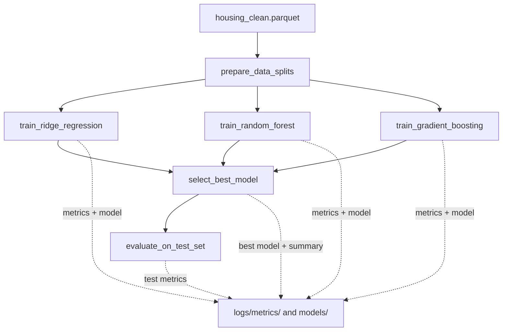

# Airflow MLOps Learning Lab

A hands-on learning project for Apache Airflow and MLOps. The tutorials build
from basic DAG concepts to data ingestion, model training, experiment tracking,
monitoring, deployment patterns, and a capstone DAG that orchestrates the
workflow.

**Suggested GitHub repository name:** `airflow-mlops-learning-lab`

## Learning path

| Tutorial | Level | What you will learn |
| --- | --- | --- |
| `tutorial_01_hello_airflow` | Basic | DAGs, Python and Bash operators, dependencies, and XCom |
| `tutorial_02_data_ingestion` | Basic | Ingesting, validating, and storing data as Parquet |
| `tutorial_03_model_training` | Basic to intermediate | Splitting data, training models in parallel, selecting a model, and evaluating it |
| `tutorial_04_mlflow_tracking` | Intermediate | MLflow experiment tracking, artifacts, and model registry |
| `tutorial_05_hyperparameter_tuning` | Intermediate | Optuna search, parallel training, and trial pruning |
| `tutorial_06_model_monitoring` | Intermediate to advanced | Drift detection, reports, alerts, and retraining triggers |
| `tutorial_07_end_to_end_pipeline` | Advanced | Quality gates, model promotion, and serving artifacts |
| `tutorial_08_gpu_training` | Advanced | GPU-accelerated PyTorch training and MLflow metrics |
| `tutorial_09_master_pipeline` | Advanced | Orchestrating the tutorial DAGs as a larger workflow |

## Tutorial 03: Model training pipeline

The DAG `tutorial_03_model_training` reads the processed housing dataset from
`data/processed/housing_clean.parquet`. It divides the data into training,
validation, and test sets, then trains Ridge Regression, Random Forest, and
Gradient Boosting models. The three training tasks run in parallel after the
data-splitting task.

The DAG selects the model with the best validation R², copies it to
`models/best_model.pkl`, and evaluates it on the held-out test set. Ridge
Regression uses a saved `StandardScaler`; the tree-based models use the
unscaled features. Metrics and the model selection summary are written as JSON
files under `logs/metrics/` and `models/`.



### Run Tutorial 03

From the project root in WSL, activate the same virtual environment used to
install Airflow, set the project paths, and test the DAG:

```bash
cd /path/to/mlops-airflow
source .venv/bin/activate
export AIRFLOW_HOME="$PWD/airflow_home"
export AIRFLOW__CORE__DAGS_FOLDER="$PWD/dags"
export PROJECT_ROOT="$PWD"

airflow dags list-import-errors
airflow dags test tutorial_03_model_training 2024-01-01
```

The command requires the processed Parquet file and the DAG's Python
dependencies, including NumPy, pandas, scikit-learn, joblib, and a Parquet
engine such as PyArrow.

## Getting started with Airflow in WSL

The setup notes used Apache Airflow 3.3.2 with Python 3.14. Use a Python
version supported by the Airflow release you install, and install Airflow with
its matching constraints file.

Create and activate a virtual environment from the project root:

```bash
cd /path/to/mlops-airflow
python3 -m venv .venv
source .venv/bin/activate
```

Install Airflow and the dependencies needed for the initial tutorials:

```bash
AIRFLOW_VERSION=3.3.2
PYTHON_VERSION=3.14
CONSTRAINT_URL="https://raw.githubusercontent.com/apache/airflow/constraints-${AIRFLOW_VERSION}/constraints-${PYTHON_VERSION}.txt"

python -m pip install "apache-airflow==${AIRFLOW_VERSION}" \
  numpy pandas scikit-learn joblib pyarrow \
  --constraint "${CONSTRAINT_URL}"
```

Configure Airflow to use this project's DAGs and metadata database, then start
the standalone instance:

```bash
export AIRFLOW_HOME="$PWD/airflow_home"
export AIRFLOW__CORE__DAGS_FOLDER="$PWD/dags"
airflow standalone
```

Keep that terminal running and open <http://localhost:8080>. Standalone
initializes Airflow and prints the generated admin password. It also saves
that password in:

```bash
cat "$AIRFLOW_HOME/simple_auth_manager_passwords.json.generated"
```

In a second WSL terminal, activate the same environment and export the same
Airflow paths before using the CLI:

```bash
cd /path/to/mlops-airflow
source .venv/bin/activate
export AIRFLOW_HOME="$PWD/airflow_home"
export AIRFLOW__CORE__DAGS_FOLDER="$PWD/dags"

airflow dags test tutorial_01_hello_airflow 2026-10-19
airflow dags trigger tutorial_01_hello_airflow
airflow dags list
airflow dags list-import-errors
```

Use `airflow dags test <dag_id> <YYYY-MM-DD>` to execute a DAG locally, or
`airflow dags trigger <dag_id>` to create a run in the running Airflow
instance.

### Troubleshoot DAG discovery

If `tutorial_03_model_training` does not appear in the DAG list or
`airflow dags test` reports that it cannot be found, run these checks from the
project directory in the same activated WSL environment:

```bash
cd /mnt/e/ML-OPS/MLWOKS/mlops-airflow/mlops-airflow
export AIRFLOW_HOME="$PWD/airflow_home"
export AIRFLOW__CORE__DAGS_FOLDER="$PWD/dags"
printf 'AIRFLOW_HOME=%s\n' "$AIRFLOW_HOME"
airflow config get-value core dags_folder
airflow dags list-import-errors
airflow dags list | grep tutorial_03_model_training
```

Confirm that `airflow config get-value core dags_folder` prints the project's
`dags` directory. If `airflow dags list-import-errors` reports missing Python
modules, install the dependencies into the active Airflow environment and
rerun the checks. For example, Tutorial 03 needs scikit-learn (imported as
`sklearn`), as well as the data and model dependencies listed above.

## Project layout

```text
.
├── dags/
│   ├── 01_basics/
│   ├── 02_intermediate/
│   ├── 03_advanced/
│   └── 04_ml_pipeline/
├── data/
│   ├── raw/
│   └── processed/
├── models/
├── logs/
├── airflow_home/
├── requirements.txt
└── README.md
```

Airflow tasks write generated model artifacts and metrics into `models/` and
`logs/`. Keep credentials, generated passwords, and other local secrets out of
source control.

## Dependency note

The setup notes and `requirements.txt` currently describe different Airflow
versions: the setup uses Airflow 3.3.2, while `requirements.txt` pins Airflow
2.9.3. Do not install both version specifications into the same environment.
Choose an Airflow version and Python version, then align the requirements and
constraints before installing the full dependency list. Later tutorials also
need additional packages such as MLflow, Optuna, Evidently, and PyTorch; see
the relevant DAG's imports and instructions before running them.
